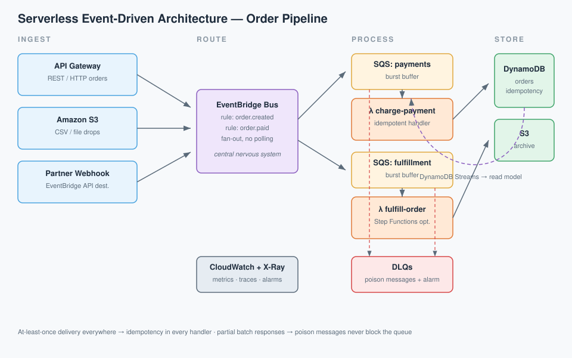

# ⚡ Serverless Event-Driven Patterns Guide


> A hands-on reference for building resilient, event-driven systems on serverless — the patterns that actually survive production traffic, not just the happy path in a tutorial.

## TL;DR

- **Event-driven > request-driven** for workloads that are bursty, decoupled, or fan-out heavy.
- **EventBridge** is your central nervous system: one bus, many rules, zero polling.
- **Idempotency is non-negotiable** — SQS/Lambda deliver at-least-once, always.
- **DLQs + alarms** turn silent failures into loud, debuggable ones.
- Serverless fails gracefully when you design for retries, timeouts, and partial batch responses.

## Architecture



An order event flows through the system:

1. **Ingest** — API Gateway (sync orders), S3 (file drops), or a partner webhook POST to an HTTP endpoint.
2. **Route** — EventBridge bus applies rules: `order.created` → payment, `order.created` → fulfillment (fan-out).
3. **Process** — Lambda functions scale from 0 to 1,000 concurrent executions in seconds; SQS queues absorb bursts.
4. **Persist** — DynamoDB (hot state, single-digit ms), S3 (cold/archive), with DynamoDB Streams feeding a denormalized read model.
5. **Observe** — CloudWatch metrics/alarms, X-Ray traces, and a DLQ per queue so poison messages never vanish.

## Compute Comparison: When Serverless Wins

| | AWS Lambda | AWS Fargate | EC2 / Autoscaling |
|---|---|---|---|
| Billing granularity | Per-ms of execution | Per-second vCPU/RAM | Per-second instance |
| Scale to zero | ✅ Yes | ❌ Min 1 task | ❌ Min 1 instance |
| Cold starts | Yes (mitigate: SnapStart, provisioned concurrency) | None | None |
| Max execution time | 15 min | No limit | No limit |
| Best for | Event handlers, APIs, ETL bursts | Long-running services, batch jobs | Stateful apps, special hardware |
| Ops burden | Lowest | Medium | Highest |

**Rule of thumb:** if it responds to events and finishes in under 15 minutes, start with Lambda. Move up the stack only when Lambda's constraints actually bite.

## Event Routing Patterns

| Pattern | Use when | AWS building block |
|---|---|---|
| Point-to-point | One producer, one consumer | SQS queue → Lambda |
| Fan-out | One event, many independent consumers | SNS topic / EventBridge bus |
| Choreography | Services react to shared events, no orchestrator | EventBridge rules + DynamoDB Streams |
| Orchestration | Strict ordering, retries, compensation | Step Functions workflows |
| Request–reply | Synchronous response needed | API Gateway → Lambda (or ALB) |

## Code Snippet: Idempotent Order Processor

Full handler in [`handler.py`](handler.py) — SQS-triggered Lambda with DynamoDB idempotency and partial batch responses:

```python
def lambda_handler(event, context):
    failures = []
    for record in event["Records"]:
        order = json.loads(record["body"])
        if not claim_idempotency(order["order_id"]):   # already processed? skip
            continue
        try:
            process_order(order)
        except Exception:
            failures.append({"itemIdentifier": record["messageId"]})  # SQS retries only these
    return {"batchItemFailures": failures}  # partial batch response
```

Why this shape: **idempotency** makes at-least-once delivery safe, and **partial batch responses** mean one poison message can't nuke the other 9 good ones in the batch.

## Cost Sanity

- Lambda free tier: **1M requests + 400k GB-seconds/month** — a small event pipeline often costs literally $0.
- The real bill drivers: **DynamoDB on-demand writes** and **data transfer**. Right-size those first.
- Set a **billing alarm at $5** on day one. Serverless surprises are always the boring resources, never Lambda.

## 🧠 Quiz Teaser

Think you've got it? [Take the 5-question quiz](quiz.md) — topics include idempotency, cold starts, partial batch responses, and EventBridge vs SNS. Answers hidden until you're ready.

---

*Built as a daily cloud-engineering study repo. PRs and corrections welcome.*
